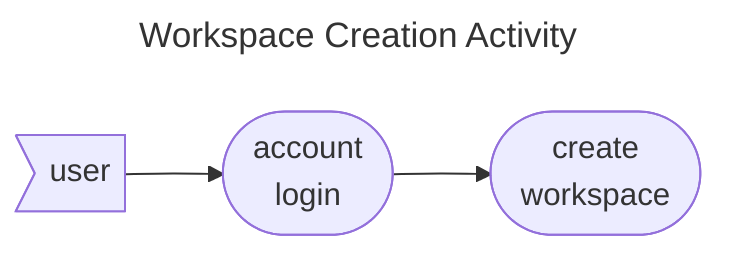
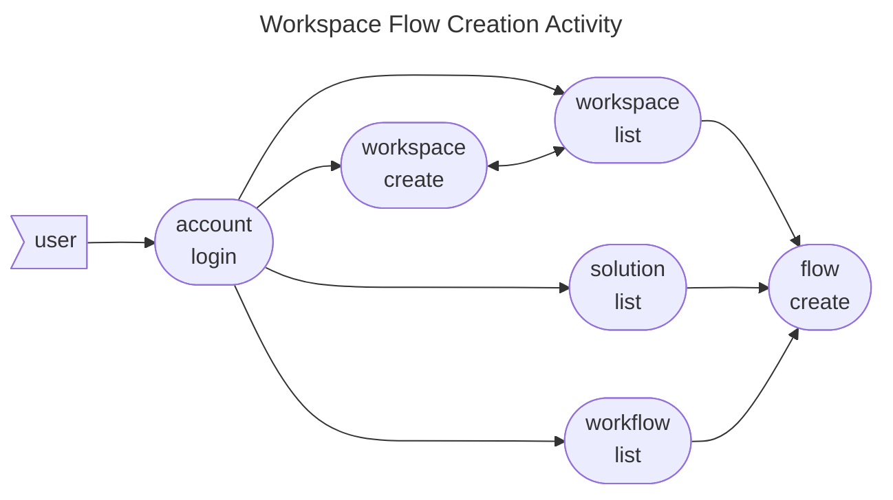
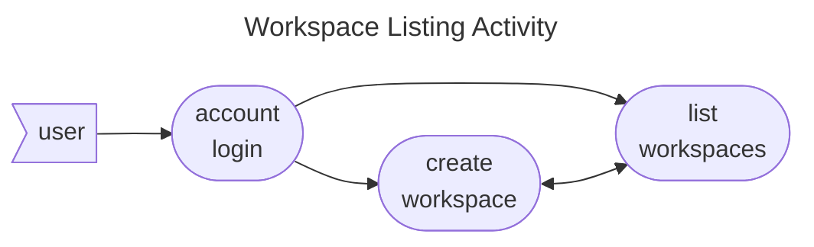
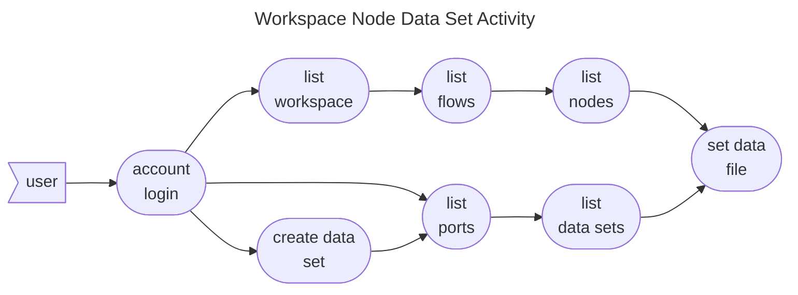
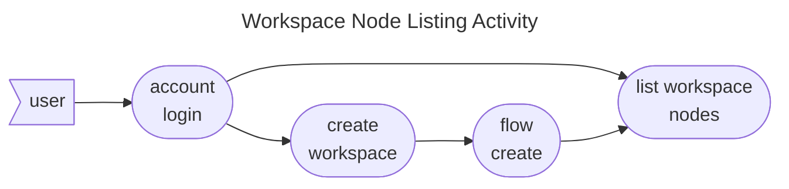
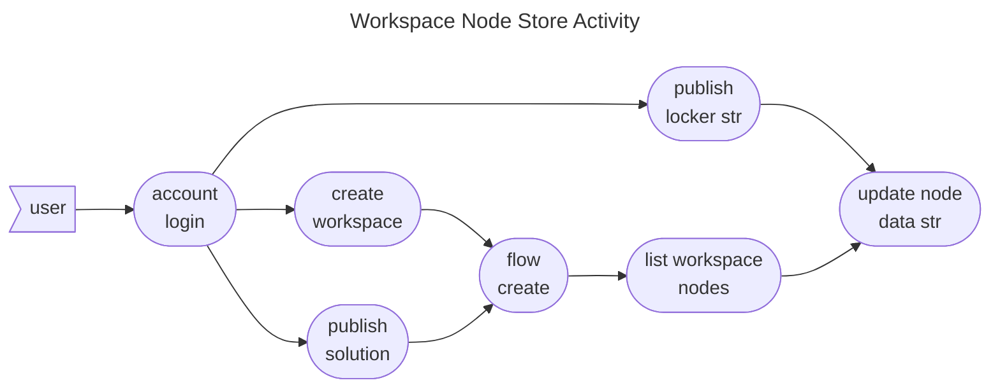

# Workspace Command Specs

The workspace command provides functionality for creating and managing workspaces provided by a Broker on a specific
account. A workspace can expose multiple Workflows from many Solutions. It provides the environment for being able to
invoke a Workflow on a groups of Agents managed by the Broker.

* [Features](#features)
    * [Workspace Creation](#workspace-creation)
    * [Workspace Flow Creation](#workspace-flow-creation)
    * [Workspace Listing](#workspace-listing)
    * [Workspace Node Data Set](#workspace-node-data-set)
    * [Workspace Node Listing](#workspace-node-listing)
    * [Workspace Node Source](#workspace-node-source)
    * [Workspace Node Store](#workspace-node-store)
* [By Command](#commands)
* [By Test Cases](#test-cases)

## Features

### Workspace Creation

The workspace creation activity is a simple user to broker request which returns a workspace resource with its creation
date and workspace id. It involves a series of scenarios detailed
under [create simple workspace](../../features/workspace/create_simple_workspace.feature).

### Workspace Flow Creation

The Workspace Flow creation activity is a complex user to broker sequence of requests which serves as a starting point
for the deployment of Solution Workflow into an orchestrated Flow execution. It involves a series of scenarios detailed
under [create workspace flow](../../features/workspace/create_workspace_flow.feature)

### Workspace Listing

The workspace listing activity is a simple user to broker request which returns the list of workspaces for an integer
flag value representing Workspace status and type. It involves a series of scenarios detailed
under [list simple use workspaces](../../features/workspace/list_simple_user_workspaces.feature)

### Workspace Node Data Set

Each node present under a Workspace Flow may accept configurations and other data files by declaring input ports for a
Smart Function. The Workspace Node Data Set activity represents a user uploading, or setting a file onto a node's input
port.

The set command of this activity can be invoked multiple times with different paths and ports. It can also be used to
overwrite previously set data. The activity is detailed under the scenarios
of [set workspace node input file](../../features/workspace/set_workspace_node_input_file.feature).

### Workspace Node Listing

Once a Workspace Flow has been created, the Orchestration assigns `Solution Workflow Nodes` to `Workspace Flow Nodes`.
These nodes are mirrored containers allowing the user to set configurations and parameters required by any Smart
Function to be executed when the `Solution Workflow` is executed.

Workspace Nodes always belong to a specific [Flow](#workspace-flow-creation). The scenario is detailed
under [list workspace nodes](../../features/workspace/list_workspace_nodes.feature).

### Workspace Node Source

With Workspace Flow Nodes discoverable, it becomes possible to extend the activity by assigning a previously
published [Data Source](../data/index.md#source-listing) to a Flow Node. This activity depends
on [Locker Publishing](../locker/index.md#data-source-publish), not detailed in the diagram, but still a necessary set
of scenarios detailed under [Add workspace node source](../../features/workspace/add_workspace_node_source.feature).

The activity provides 2 commands: Adding a data source and removing it. Both commands follow the same command
specification and pattern:

### Workspace Node Store

With Workspace Flow Nodes discoverable, it becomes possible to extend the activity by assigning a previously
published [Data Store](../data/index.md#store-listing) to a Flow Node. This activity depends
on [Locker Publishing](../locker/index.md#data-source-publish), not detailed in the diagram, but still a necessary set
of scenarios detailed under [Add workspace node store](../../features/workspace/add_workspace_node_store.feature).

The activity provides 2 commands: Adding a data store and removing it. Both commands follow the same command
specification and pattern:

## Commands

* [create](create.md)
* [flow](flow.md)
* [list](list.md)
* [node](node.md#workspace-node)

## Test Cases

* [Add workspace node source](../../features/workspace/add_workspace_node_source.feature)
* [Add workspace node store](../../features/workspace/add_workspace_node_store.feature)
* [Create simple workspace](../../features/workspace/create_simple_workspace.feature)
* [Create workspace flow](../../features/workspace/create_workspace_flow.feature)
* [List simple user workspaces](../../features/workspace/list_simple_user_workspaces.feature)
* [List workspace nodes](../../features/workspace/list_workspace_nodes.feature)
* [Set Workspace Node Input File](../../features/workspace/set_workspace_node_input_file.feature)
